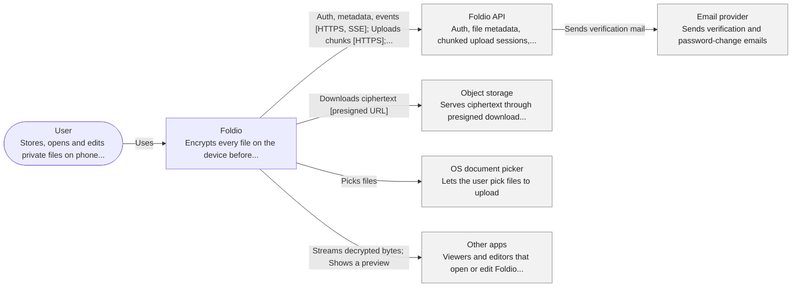
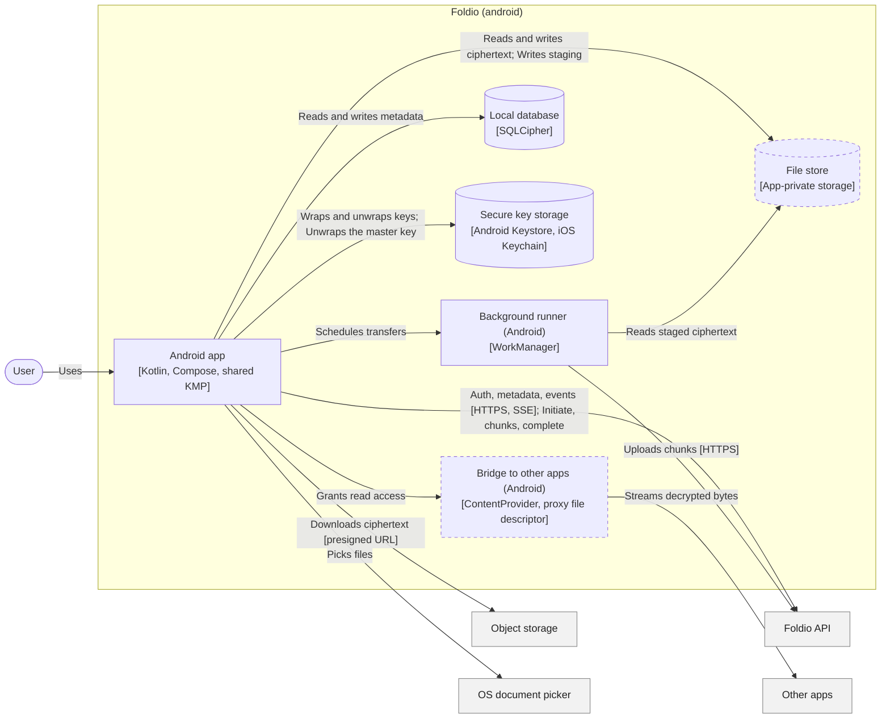
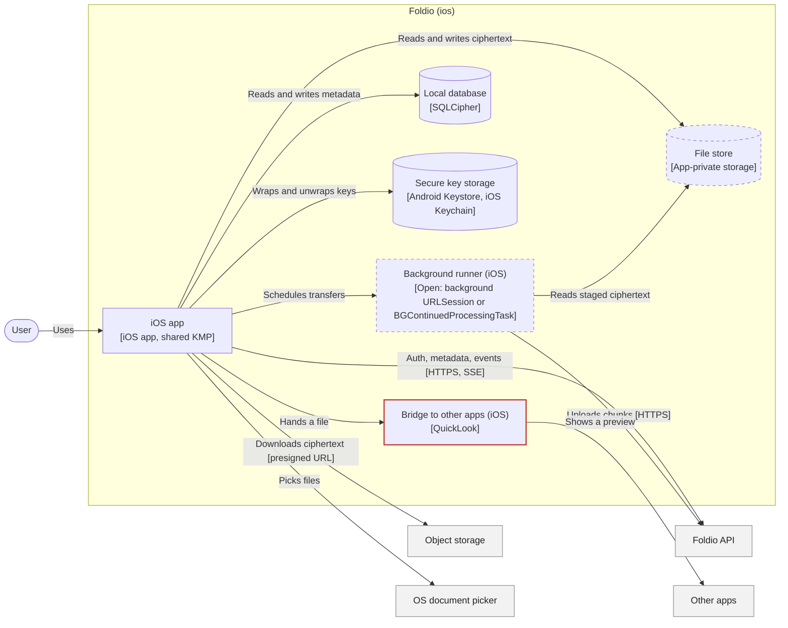
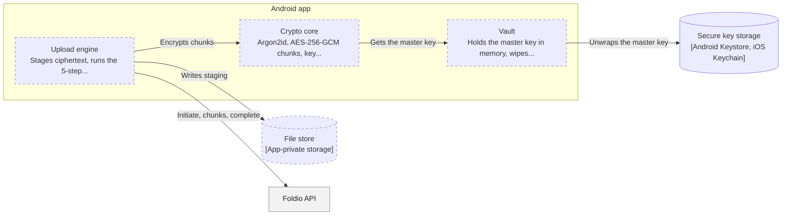

<!-- Generated by tools/graph.py. Do not edit by hand: change architecture.json and run the script. -->

# Architecture: Foldio

Encrypted, offline-first file app for Android and iOS, built from one shared KMP codebase.

Dashed border: open, not decided yet. Red border: conflict between sources. Grey: external system.

## Elements

| ID | Name | Kind | Parent | Platform | Tech | Status | Description | Source |
|---|---|---|---|---|---|---|---|---|
| `user` | User | person |  |  |  | given | Stores, opens and edits private files on phone and tablet | REQUIREMENTS.md R1 |
| `foldio` | Foldio | system |  |  |  | given | Encrypts every file on the device before upload; reading works offline | REQUIREMENTS.md R1 |
| `api` | Foldio API | external |  |  |  | given | Auth, file metadata, chunked upload sessions, live events | API.md |
| `object-storage` | Object storage | external |  |  |  | given | Serves ciphertext through presigned download URLs | API.md downloads |
| `email` | Email provider | external |  |  |  | given | Sends verification and password-change emails | API.md /auth/verify |
| `doc-picker` | OS document picker | external |  |  |  | given | Lets the user pick files to upload | REQUIREMENTS.md Upload |
| `other-apps` | Other apps | external |  |  |  | given | Viewers and editors that open or edit Foldio files | REQUIREMENTS.md Hand-off |
| `android` | Android app | container | foldio | android | Kotlin, Compose, shared KMP | given | UI and shared logic on Android |  |
| `ios` | iOS app | container | foldio | ios | iOS app, shared KMP | given | UI and shared logic on iOS |  |
| `android-runner` | Background runner (Android) | container | foldio | android | WorkManager | given | Runs uploads and downloads after a kill or a reboot | REQUIREMENTS.md Reliability |
| `ios-runner` | Background runner (iOS) | container | foldio | ios | Open: background URLSession or BGContinuedProcessingTask | open | Runs transfers while the app is in the background |  |
| `local-db` | Local database | store | foldio |  | SQLCipher | given | Metadata, names (encrypted), upload queue | REQUIREMENTS.md Security |
| `file-store` | File store | store | foldio |  | App-private storage | open | Areas: look-once cache, pinned, upload staging, edit copy |  |
| `secure-storage` | Secure key storage | store | foldio |  | Android Keystore, iOS Keychain | given | Hardware-backed keys, biometric-wrapped master key | REQUIREMENTS.md Security |
| `android-bridge` | Bridge to other apps (Android) | container | foldio | android | ContentProvider, proxy file descriptor | open | Streams decrypted bytes to another app |  |
| `ios-bridge` | Bridge to other apps (iOS) | container | foldio | ios | QuickLook | conflict | Shows a preview of a decrypted file |  |
| `crypto-core` | Crypto core | component | android |  |  | open | Argon2id, AES-256-GCM chunks, key wrapping |  |
| `vault` | Vault | component | android |  |  | open | Holds the master key in memory, wipes it on lock |  |
| `upload-engine` | Upload engine | component | android |  |  | open | Stages ciphertext, runs the 5-step upload |  |

## Level 1: context

## Level 2: containers of Foldio, android

## Level 2: containers of Foldio, ios

## Level 3: components of Android app

## Data and trust zones

Orange: plaintext. Green: encrypted. Dashed arrow: must never cross.

```mermaid
flowchart LR
  subgraph n_z_memory["App memory"]
    n_d_password_memory["Password<br/>plaintext"]:::plain
    n_d_master_key_memory["Master key<br/>plaintext"]:::plain
    n_d_auth_key_memory["authKey<br/>plaintext"]:::plain
    n_d_dek_memory["DEK (per version)<br/>plaintext"]:::plain
    n_d_file_content_memory["File content<br/>plaintext"]:::plain
  end
  subgraph n_z_app_storage["App storage"]
    n_d_tokens_app_storage["Access and refresh tokens<br/>encrypted"]:::encopen
    n_d_file_content_app_storage["File content<br/>encrypted"]:::enc
    n_d_file_names_app_storage["File and folder names<br/>encrypted"]:::enc
  end
  subgraph n_z_secure_hw["Keystore or Keychain"]
    n_d_master_key_secure_hw["Master key<br/>encrypted"]:::enc
  end
  n_z_other_apps["Other apps"]
  subgraph n_z_user_storage["User-visible storage"]
    n_d_file_content_user_storage["File content<br/>plaintext"]:::plain
  end
  subgraph n_z_server["Foldio server"]
    n_d_master_key_server["Master key<br/>encrypted"]:::enc
    n_d_dek_server["DEK (per version)<br/>encrypted"]:::enc
    n_d_file_content_server["File content<br/>encrypted"]:::enc
    n_d_file_names_server["File and folder names<br/>plaintext"]:::plain
  end
  n_z_backup["OS backup"]
  n_z_memory -- "authKey" --> n_z_server
  n_z_memory -. "never: Password" .-> n_z_server
  n_z_memory -. "never: Master key" .-> n_z_app_storage
  n_z_memory -- "File content" --> n_z_app_storage
  n_z_memory -- "File content" --> n_z_other_apps
  n_z_memory -- "File content" --> n_z_user_storage
  n_z_app_storage -- "File content, File and folder names" --> n_z_server
  n_z_app_storage -. "never: File content, File and folder names, Access and refresh tokens" .-> n_z_backup
  classDef plain fill:#fff1e0,stroke:#d35400,color:#222
  classDef enc fill:#e8f4ea,stroke:#2e7d32,color:#222
  classDef plainopen fill:#fff1e0,stroke:#d35400,color:#222,stroke-dasharray: 5 5
  classDef encopen fill:#e8f4ea,stroke:#2e7d32,color:#222,stroke-dasharray: 5 5
```

| Data | Zone | Plaintext | Survives process death | Background access | Status | Notes or source |
|---|---|---|---|---|---|---|
| Password | App memory | yes | no | no | given | REQUIREMENTS.md Security |
| Master key | App memory | yes | no | no | given | REQUIREMENTS.md Security |
| Master key | Keystore or Keychain | no | yes | no | given | Biometric-wrapped copy |
| Master key | Foldio server | no | yes |  | given | wrappedMasterKey: IV, ciphertext, tag |
| authKey | App memory | yes | no |  | given | API.md /auth/login |
| Access and refresh tokens | App storage | no | yes | yes | open | Storage and refresh: decision stop D5 |
| DEK (per version) | App memory | yes | no |  | given | REQUIREMENTS.md Security |
| DEK (per version) | Foldio server | no | yes |  | given | wrappedDek, wrapped under the master key |
| File content | App memory | yes | no |  | given | REQUIREMENTS.md Security |
| File content | App storage | no | yes | yes | given | REQUIREMENTS.md Security |
| File content | Foldio server | no | yes |  | given | REQUIREMENTS.md Security |
| File content | User-visible storage | yes | yes |  | given | Only the user's Download action |
| File and folder names | App storage | no | yes |  | given | Encrypted in SQLCipher |
| File and folder names | Foldio server | yes | yes |  | given | Names and paths are plaintext on the server |

### Crossings

| From | To | Data | Allowed | Rule | Status | Source |
|---|---|---|---|---|---|---|
| App memory | Foldio server | authKey | yes | Only SHA-256 of an Argon2id output | given | API.md /auth/login |
| App memory | Foldio server | Password | no | The password never leaves the device | given | REQUIREMENTS.md Security |
| App memory | App storage | Master key | no | Never written to disk in plaintext | given | REQUIREMENTS.md Authentication |
| App memory | App storage | File content | yes | Only ciphertext | given | REQUIREMENTS.md Upload, Download |
| App memory | Other apps | File content | yes | Read-only; no plaintext on disk (Q2: QuickLook needs a file) | conflict | REQUIREMENTS.md Hand-off |
| App memory | User-visible storage | File content | yes | Only through the user's Download action | given | REQUIREMENTS.md Download |
| App storage | Foldio server | File content, File and folder names | yes | Content as ciphertext; names in plaintext | given | API.md upload |
| App storage | OS backup | File content, File and folder names, Access and refresh tokens | no | All on-disk data is excluded from backups | given | REQUIREMENTS.md Security |

## Responsibilities

| Concern | Owner | Status | Source | Notes |
|---|---|---|---|---|
| Derive keys from the password | client | given | REQUIREMENTS.md Security |  |
| Set the KDF parameters | server | given | API.md /auth/params |  |
| Verify authKey | server | given | API.md /auth/login |  |
| Encrypt and decrypt file content | client | given | REQUIREMENTS.md Security |  |
| Detect name collisions | server | given | API.md 409 FILE_DUPLICATE_NAME |  |
| Detect version conflicts | server | given | API.md baseVersionId |  |
| Resolve conflicts (Keep Mine, Keep Both, Use Server) | client | given | REQUIREMENTS.md Conflicts |  |
| Enforce quota | server | given | API.md STORAGE_QUOTA_EXCEEDED |  |
| Copy and restore versions | server | given | API.md /copy, /restore |  |
| Cap pinned refresh at 500 MB a day | client | given | REQUIREMENTS.md Reliability |  |
| Resume transfers after a reboot | os | given | REQUIREMENTS.md Reliability | WorkManager on Android; iOS runner is open (D9) |
| Refresh tokens one caller at a time | client | open |  | Decision stop D5 |
| Evict the look-once cache | client | open |  | Decision stop D11 |
