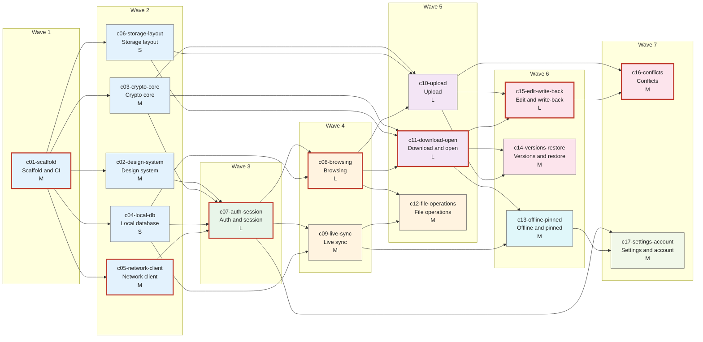
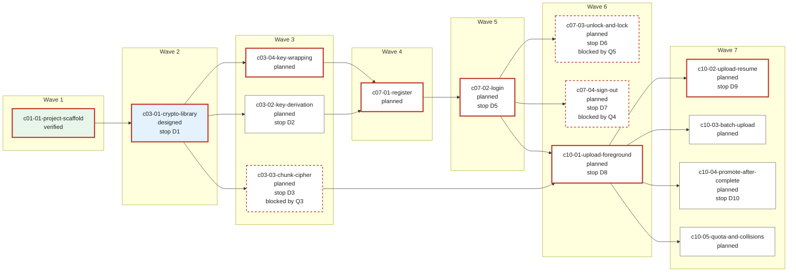

<!-- Generated by tools/graph.py. Do not edit by hand: change graph.json and run the script. -->

# Work graph: Foldio

17 chunks in 7 waves. 14 changes planned.

**Chunk critical path:** `c01-scaffold` → `c05-network-client` → `c07-auth-session` → `c08-browsing` → `c11-download-open` → `c15-edit-write-back` → `c16-conflicts`

## Chunk waves

Chunks in the same wave can be built in parallel.

| Wave | Chunks |
|---|---|
| 1 | `c01-scaffold` (M) |
| 2 | `c02-design-system` (M), `c03-crypto-core` (M), `c04-local-db` (S), `c05-network-client` (M), `c06-storage-layout` (S) |
| 3 | `c07-auth-session` (L) |
| 4 | `c08-browsing` (L), `c09-live-sync` (M) |
| 5 | `c12-file-operations` (M), `c10-upload` (L), `c11-download-open` (L) |
| 6 | `c13-offline-pinned` (M), `c14-versions-restore` (M), `c15-edit-write-back` (L) |
| 7 | `c16-conflicts` (M), `c17-settings-account` (M) |

## Chunks

| Chunk | Title | Area | Kind | Size | Wave | Depends on | Unlocks | Changes |
|---|---|---|---|---|---|---|---|---|
| `c01-scaffold` | Scaffold and CI | foundation | foundation | M | 1 |  | c02-design-system, c03-crypto-core, c04-local-db, c05-network-client, c06-storage-layout | 1 |
| `c02-design-system` | Design system | foundation | foundation | M | 2 | c01-scaffold | c07-auth-session | not sliced |
| `c03-crypto-core` | Crypto core | foundation | foundation | M | 2 | c01-scaffold | c07-auth-session, c10-upload, c11-download-open | 4 |
| `c04-local-db` | Local database | foundation | foundation | S | 2 | c01-scaffold | c07-auth-session, c08-browsing, c09-live-sync | not sliced |
| `c05-network-client` | Network client | foundation | foundation | M | 2 | c01-scaffold | c07-auth-session | not sliced |
| `c06-storage-layout` | Storage layout | foundation | foundation | S | 2 | c01-scaffold | c10-upload, c11-download-open | not sliced |
| `c07-auth-session` | Auth and session | auth | capability | L | 3 | c02-design-system, c03-crypto-core, c04-local-db, c05-network-client | c08-browsing, c09-live-sync, c17-settings-account | 4 |
| `c08-browsing` | Browsing | files | capability | L | 4 | c07-auth-session, c04-local-db | c10-upload, c11-download-open, c12-file-operations | not sliced |
| `c09-live-sync` | Live sync | files | capability | M | 4 | c07-auth-session, c04-local-db | c12-file-operations, c13-offline-pinned | not sliced |
| `c12-file-operations` | File operations | files | capability | M | 5 | c08-browsing, c09-live-sync |  | not sliced |
| `c10-upload` | Upload | transfer | capability | L | 5 | c03-crypto-core, c06-storage-layout, c08-browsing | c14-versions-restore, c15-edit-write-back, c16-conflicts | 5 |
| `c11-download-open` | Download and open | transfer | capability | L | 5 | c03-crypto-core, c06-storage-layout, c08-browsing | c13-offline-pinned, c14-versions-restore, c15-edit-write-back | not sliced |
| `c13-offline-pinned` | Offline and pinned | offline | capability | M | 6 | c11-download-open, c09-live-sync | c17-settings-account | not sliced |
| `c14-versions-restore` | Versions and restore | editing | capability | M | 6 | c11-download-open, c10-upload |  | not sliced |
| `c15-edit-write-back` | Edit and write-back | editing | capability | L | 6 | c10-upload, c11-download-open | c16-conflicts | not sliced |
| `c16-conflicts` | Conflicts | editing | capability | M | 7 | c10-upload, c15-edit-write-back |  | not sliced |
| `c17-settings-account` | Settings and account | settings | capability | M | 7 | c07-auth-session, c13-offline-pinned |  | not sliced |

## Change waves

Changes in the same wave can be built in parallel, in separate worktrees.

**Change critical path:** `c01-01-project-scaffold` → `c03-01-crypto-library` → `c03-04-key-wrapping` → `c07-01-register` → `c07-02-login` → `c10-01-upload-foreground` → `c10-02-upload-resume`

| Wave | Changes |
|---|---|
| 1 | `c01-01-project-scaffold` |
| 2 | `c03-01-crypto-library` |
| 3 | `c03-02-key-derivation`, `c03-03-chunk-cipher`, `c03-04-key-wrapping` |
| 4 | `c07-01-register` |
| 5 | `c07-02-login` |
| 6 | `c07-03-unlock-and-lock`, `c07-04-sign-out`, `c10-01-upload-foreground` |
| 7 | `c10-02-upload-resume`, `c10-03-batch-upload`, `c10-04-promote-after-complete`, `c10-05-quota-and-collisions` |

## Ready now

- `c03-01-crypto-library`: Crypto library and test vectors (designed)

## Changes

| Change | Chunk | Kind | Size | Wave | Depends on | Stops | Blocked by | Status | Groups |
|---|---|---|---|---|---|---|---|---|---|
| `c01-01-project-scaffold` | c01-scaffold | foundation | M | 1 |  |  |  | verified | Build setup → CI → Konsist and detekt |
| `c03-01-crypto-library` | c03-crypto-core | foundation | S | 2 | c01-01-project-scaffold | D1 |  | designed | Domain → Android → iOS |
| `c03-02-key-derivation` | c03-crypto-core | foundation | S | 3 | c03-01-crypto-library | D2 |  | planned | Domain → Android → iOS |
| `c03-03-chunk-cipher` | c03-crypto-core | foundation | M | 3 | c03-01-crypto-library | D3 | Q3 | planned | Domain → Android → iOS |
| `c03-04-key-wrapping` | c03-crypto-core | foundation | S | 3 | c03-01-crypto-library |  |  | planned | Domain → Platform actuals |
| `c07-01-register` | c07-auth-session | vertical | M | 4 | c03-02-key-derivation, c03-04-key-wrapping |  |  | planned | Domain → Data: auth API → Presentation: Create account → Presentation: Verify email |
| `c07-02-login` | c07-auth-session | vertical | M | 5 | c07-01-register | D5 |  | planned | Domain → Data: auth API → Data: token store → Presentation: Sign in |
| `c07-03-unlock-and-lock` | c07-auth-session | vertical | M | 6 | c07-02-login | D6 | Q5 | planned | Domain → Android: biometric key → iOS: biometric key → Presentation: Unlock |
| `c07-04-sign-out` | c07-auth-session | vertical | S | 6 | c07-02-login | D7 | Q4 | planned | Domain → Data: wipe local data → Presentation: Sign out dialog |
| `c10-01-upload-foreground` | c10-upload | vertical | M | 6 | c03-03-chunk-cipher, c07-02-login | D8 |  | planned | Domain → Data: staging store → Data: upload API → Presentation: picker and snackbar |
| `c10-02-upload-resume` | c10-upload | vertical | M | 7 | c10-01-upload-foreground | D9 |  | planned | Domain → Android: worker → iOS: background transfer |
| `c10-03-batch-upload` | c10-upload | vertical | S | 7 | c10-01-upload-foreground |  |  | planned | Domain → Data: upload queue → Presentation: progress sheet |
| `c10-04-promote-after-complete` | c10-upload | vertical | S | 7 | c10-01-upload-foreground | D10 |  | planned | Domain → Data: promotion owner → Data: startup repair |
| `c10-05-quota-and-collisions` | c10-upload | vertical | S | 7 | c10-01-upload-foreground |  |  | planned | Domain → Data: error mapping → Presentation: collision dialog |

## Warnings

- wave 3 is a single L chunk ('c07-auth-session'): a bottleneck, consider splitting it
